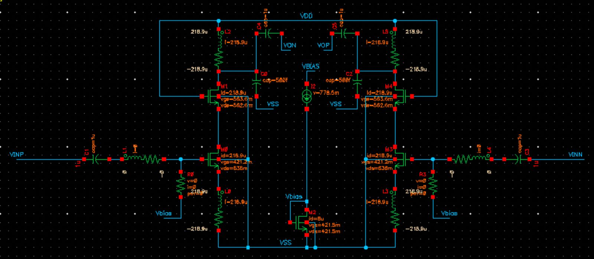
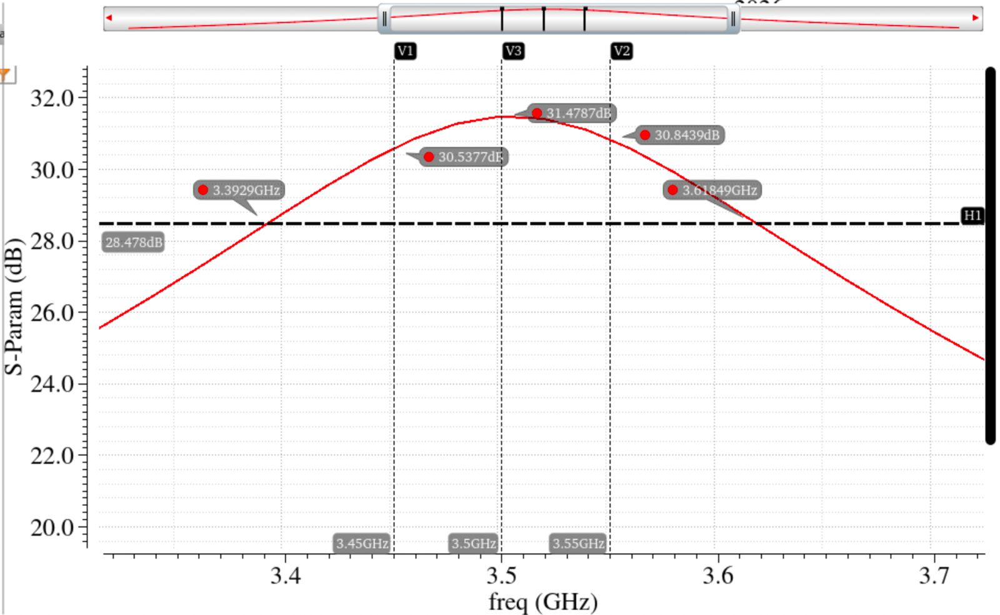
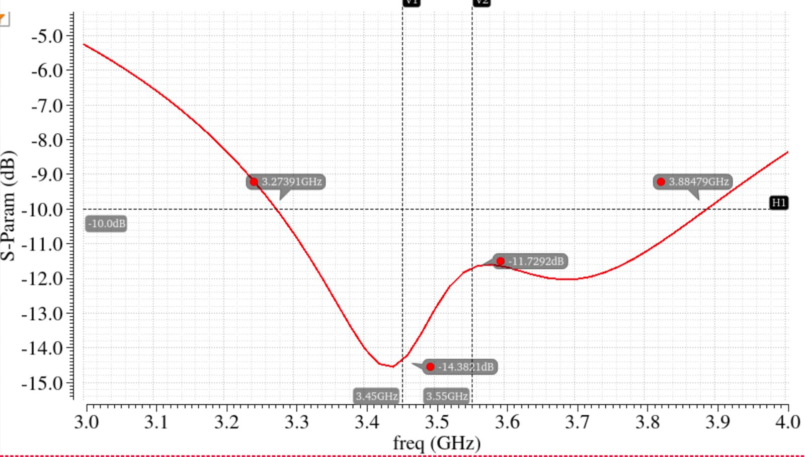
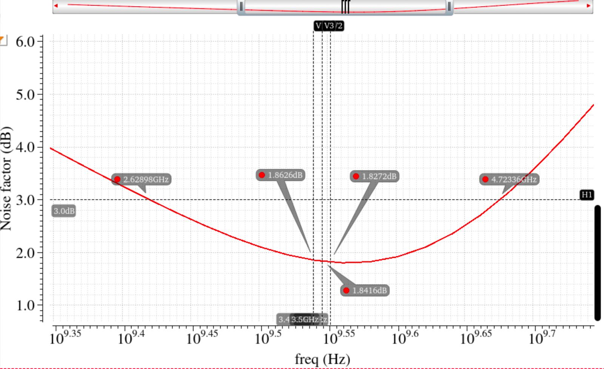
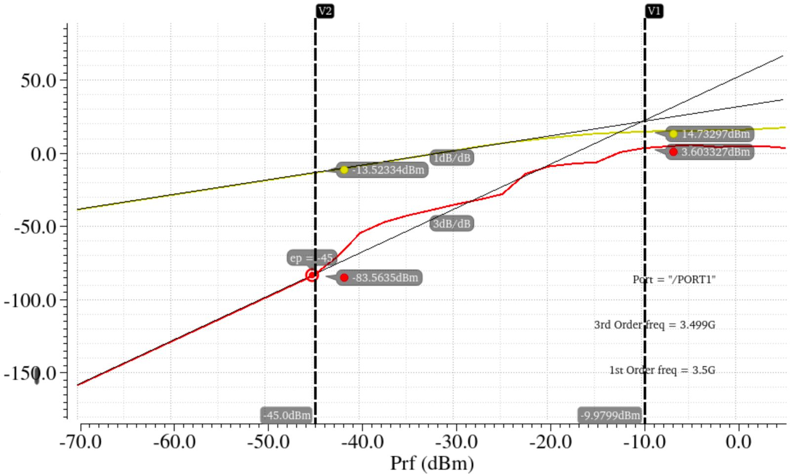
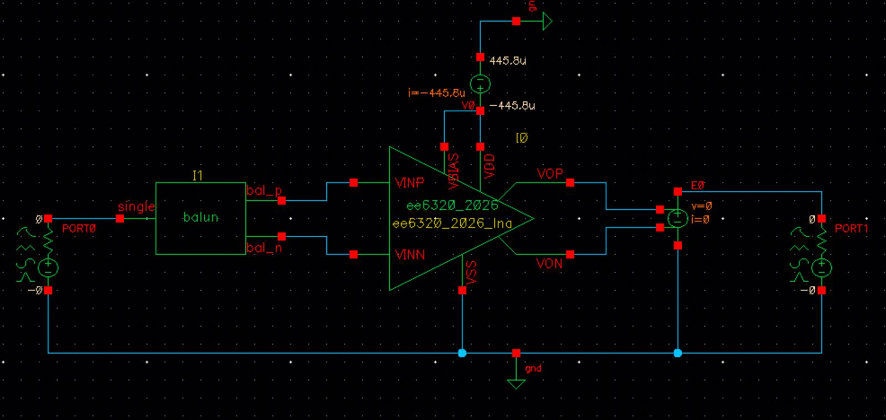

# Project 1: Differential Cascoded CS Low Noise Amplifier (3.45–3.55 GHz)

Differential cascoded common-source LNA with inductive source degeneration, designed in IBM 130 nm CMOS (VDD = 1.2 V) for a differential 100 Ω input driven through an ideal balun, with a 200 fF minimum load per output (the expected mixer input).



## Specifications

| Specification | Target |
|---|---|
| Frequency of operation | 3.45–3.55 GHz |
| Input matching | Differential Rin = 100 Ω, S11 < −10 dB across the band |
| Load | 200 fF minimum at each output |
| Differential voltage gain | ≥ 20 dB across the band |
| Gain flatness | ≤ 1 dB |
| Noise figure | ≤ 2 dB |
| IIP3 | ≥ −10 dBm (two tones 1 MHz apart) |
| Power | Minimise (VDD = 1.2 V) |

## Performance summary

| Design metric | Measurement | Simulation result | Requirement |
|---|---|---|---|
| Input matching | Worst case S11 in the specified band | −11.7292 dB | < −10 dB |
| | Band over which S11 ≤ −10 dB | 3273.9–3884.7 MHz | 3450 to 3550 MHz |
| Voltage gain | Minimum gain in the specified band | 30.551 dB | ≥ 20 dB |
| | Maximum gain in the specified band | 31.478 dB | ≥ 20 dB |
| | Gain flatness in specified band | 0.927 dB | ≤ 1 dB |
| | 3 dB bandwidth | 226 MHz | — |
| | Load capacitance (differential) | 500 fF | 200 fF |
| Noise figure | Maximum NF in the specified band | 1.859 dB | ≤ 2 dB |
| | Minimum NF in the specified band | 1.819 dB | — |
| | Band over which NF ≤ 3 dB | 2.63–4.725 GHz | — |
| Linearity | IIP3 tones used | 3.5 GHz, 3.501 GHz | — |
| | Input power used for extrapolation | −45 dB | — |
| | Power of fundamental tone at output | −13.52 dBm | — |
| | Power of IM3 tone at output | −83.56 dBm | — |
| | Extrapolated IIP3 | −9.97 dBm | ≥ −10 dBm |
| Power | LNA DC power consumption (excluding bias) | 525.36 µW | Minimise |
| | Bias circuit power consumption | 9.6 µW | Minimise |
| Other | Sum of all on-chip inductances | 10.7 nH | — |
| | Sum of all off-chip inductances (2 Lg's) | 18 nH | — |
| | Simulator used | ADE L | — |

## Component values (one side)

| Design component | Hand calculated value | Simulated value |
|---|---|---|
| Lg (gate inductance) | 11.58 nH | 9 nH |
| Ls (source inductance) | 1.668 nH | 1.4 nH |
| Ld (drain inductance) | 4.135 nH | 3.95 nH |
| Rd (drain resistance) | 1818.66 Ω (Q = 20, Ld = 4.135 nH) | 1563.5 Ω (Q = 18, Ld = 3.95 nH) |
| R_ls (resistance parallel with Ls) | 733.6 Ω (Q = 20, Ls = 1.668 nH) | 615.7 Ω (Q = 20, Ls = 1.4 nH) |
| Rg (resistance parallel with Lg) | 12.732 kΩ (Q = 50, Lg = 11.58 nH) | 9.89 kΩ (Q = 50, Lg = 9 nH) |

- LNA MOS: W = 125 µm, L = 120 nm
- Current mirror MOS: W = 6.25 µm, L = 120 nm
- I_bias: 8 µA
- C_coupling: 1 µF

Hand calculations: maximum gain 33.89 dB, NF 1.143 dB. Simulated: maximum gain 31.378 dB, NF 1.8416 dB, IIP3 −9.9799 dBm, 1 dB compression point −20.04 dB.

## Design procedure

Starting with a 5 µm width, I swept current vs gm and Cgs to choose a high ωT for a better noise figure, but IIP3 turned out to be poor. I kept increasing the width until there was enough headroom in IIP3 and NF to tune the other parameters, settling on a 125 µm width and 200 µA to calculate the remaining component values. After tuning, the actual DC current in the differential branch was 218 µA. A 20:1 width ratio was used for the current mirror with an 8 µA bias current. Only the drain inductor's Q was changed (to 18) for gain flatness.

## Plots

| Voltage gain | S11 |
|---|---|
|  |  |
| **Noise figure** | **IIP3** |
|  |  |
| **Testbench: S11, NF, IIP3** | **Testbench: voltage gain** |
|  |  |

Hand calculations: [page 1](figures/hand_calculations_1.png), [page 2](figures/hand_calculations_2.png)

## Files

```
report/LNA_Report_EE23B114.pdf
figures/
cadence/ee6320_2026_lna/   LNA cell (schematic, symbol)
cadence/LNA_TB/            Testbench (schematic and ADE states)
```
