# Project 2: Double-Balanced Gilbert Cell I/Q Mixer (RF 3.45–3.55 GHz)

Fully differential double-balanced Gilbert cell active mixer with I and Q outputs for a direct-conversion receiver, designed in IBM 130 nm CMOS (VDD = 1.2 V), with LO = 3.5 GHz and a 10 MHz baseband. The mixer is then cascaded with the LNA from Project 1.

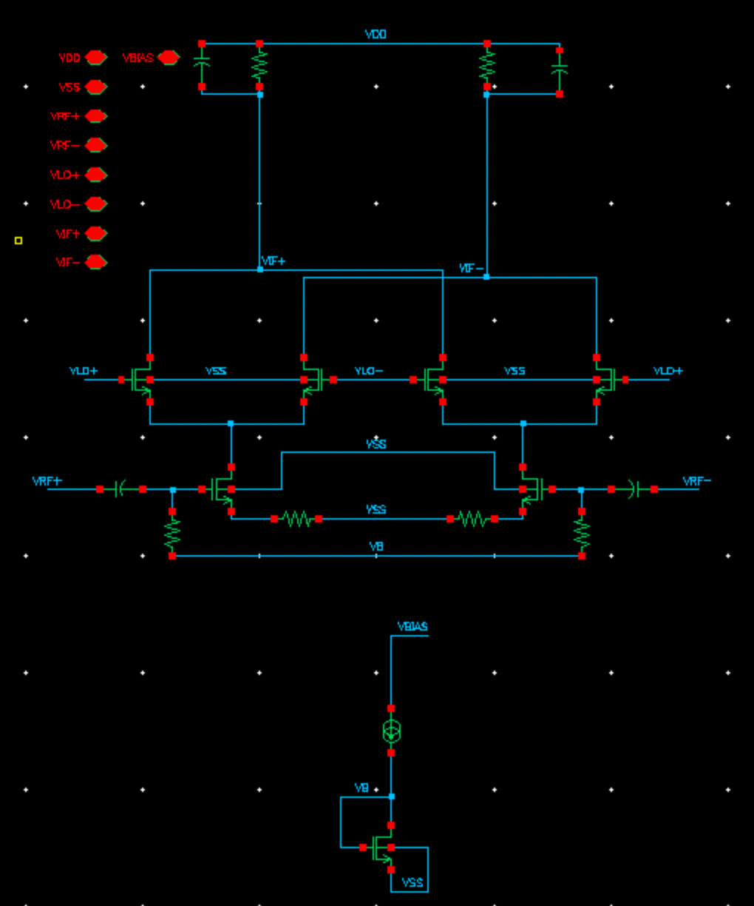

## Specifications

| Specification | Target |
|---|---|
| RF frequency / LO frequency | 3.45–3.55 GHz / 3.5 GHz |
| Baseband bandwidth | 10 MHz, maximum droop 1 dB at +10 MHz |
| Conversion gain | > 20 dB |
| SSB noise figure | ≤ 12 dB (integrated 1 kHz–10 MHz) |
| IIP2 | ≥ +20 dBm (0.5% systematic mismatch between halves) |
| IIP3 | ≥ −5 dBm |
| Power | Minimise (VDD = 1.2 V) |

## Mixer performance summary

| Design metric | Measurement | Performance | Specification |
|---|---|---|---|
| Conversion gain | Gain in the specified band (fRF = fLO) | 20.26 dB | > 20 dB |
| | Gain in the specified band (fRF = fLO + 10 MHz) | 20.21 dB | > 20 dB |
| | Peak gain flatness in specified band | 0.05 dB | — |
| | 3 dB RF bandwidth | 101.85 MHz | — |
| Noise figure | Integrated SSB NF for fLO = 3.5 GHz | 10.643 dB | ≤ 12 dB |
| Linearity: IIP2 | Input power used for extrapolation | −50 dBm | — |
| | Power of fundamental tone at output | −29.75 dBm | — |
| | Power of IM2 tone at output | −148.21 dBm | — |
| | Extrapolated IIP2 (mismatch of 0.5%) | 68.46 dBm | ≥ +20 dBm |
| Linearity: IIP3 | Input power used for extrapolation | −50 dBm | — |
| | Power of fundamental tone at output | −29.75 dBm | — |
| | Power of IM3 tone at output | −121.74 dBm | — |
| | Extrapolated IIP3 | −4.0029 dBm | ≥ −5 dBm |
| Power | Mixer DC power consumption (excluding bias) | Total = 0.782 mW (each = 0.3911 mW) | Minimise |
| | Bias circuit power consumption | 28.8 µW | Minimise |
| Other | Load chosen (each R_load) | 2.15 kΩ | — |
| | Differential mixer input capacitance (Cgs, each RF FET) | 29.92 fF | — |
| | Sum of all inductances | 0 | — |
| | Simulator used | ADE L, Spectre | — |

## LNA + mixer cascade

| Design metric | Condition | LNA | Mixer | Cascade (expected) | Cascade (simulated) |
|---|---|---|---|---|---|
| Conversion gain | fIN = fLO | 31.47 dB | 20.26 dB | 42.7 dB | 39.017 dB |
| | fIN = fLO + 10 MHz | 31.44 dB | 20.21 dB | 42.6 dB | 38.935 dB |
| | fIN = fLO − 10 MHz | 31.37 dB | 20.23 dB | 42.6 dB | 38.934 dB |
| Noise figure | fIN = fLO | 1.836 dB | 9.375 dB | 2.81 dB | 2.22 dB |
| | fIN = fLO + 10 MHz | 1.84 dB | 9.59 dB | 2.81 dB | 2.25 dB |
| | fIN = fLO − 10 MHz | 1.832 dB | 9.601 dB | 2.81 dB | 2.249 dB |
| IIP3 | Extrapolated IIP3 | −9.97 dBm | −4.0029 dBm | — | −26.57 dBm |
| Power | Total (excluding bias) | 525.36 µW | 782 µW | 1.307 mW | 1.401 mW |
| | Bias circuit | 9.6 µW | 28.8 µW | 38.4 µW | 40.3 µW |

Simulated cascade gain is about 3 dB below the expected value because of mismatches between the mixer and the LNA and other non-idealities.

## Design values

| Design variable | Value |
|---|---|
| Load resistance (each side) | 2.15 kΩ |
| Length of all MOS | 120 nm |
| Width of switch MOS (all 4) | 75 µm |
| Width of transconductance MOS (both) | 20 µm |
| Bias current | 12 µA for the mirror, 162 µA through each transconductance FET |
| LO amplitude | 650 mV |

Current mirror MOS W = 1 µm, L = 120 nm; coupling capacitors 10 pF and bias resistors 10 kΩ for each transconductance FET.

**LO waveform:** frequency 3.5 GHz; delay 0 for the I LO and 0.25/(3.5 GHz) for the Q LO; pulse width 0.40/(3.5 GHz); rise/fall time 0.1/(3.5 GHz).

## Design procedure

- Started with a width of 20 µm and found the load resistor from the required gain. Starting with a 1.2 V LO amplitude, tuned the load resistor and LO amplitude to reach the edge of the gain and NF specifications.
- Tried current bleeding and degeneration resistors to improve IIP3, but these degraded NF. Instead, increased the cascode width at the same bias current for a lower Vdsat and more swing, which improved IIP3.
- Finally, reduced the bias current as far as possible while still meeting all specifications.

## Plots

| Conversion gain | Noise figure |
|---|---|
| 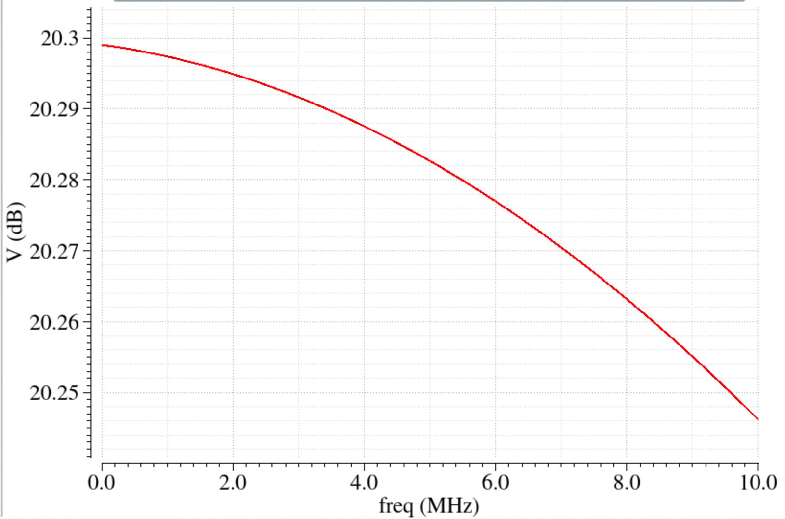 | 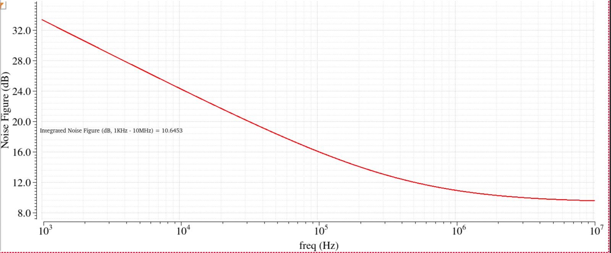 |
| **IIP2** | **IIP3** |
| 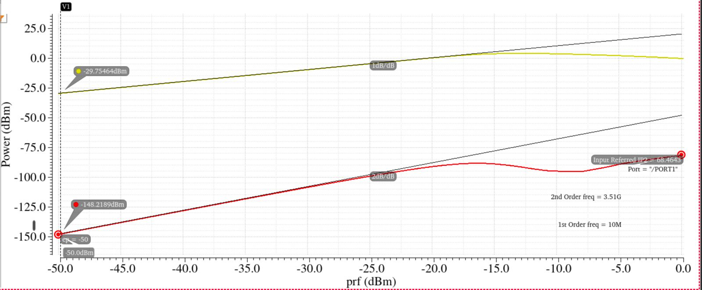 | 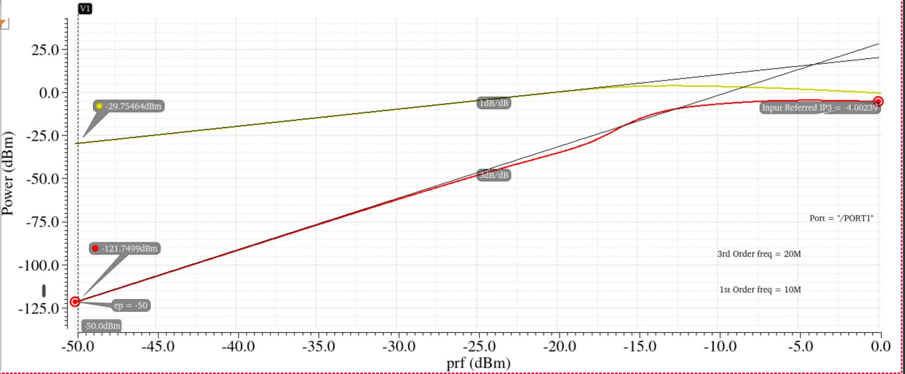 |
| **3 dB bandwidth** | **LO waveforms (I and Q)** |
| 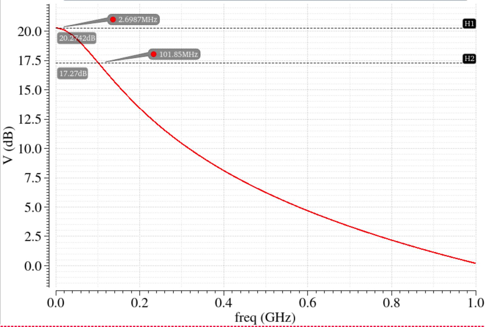 | 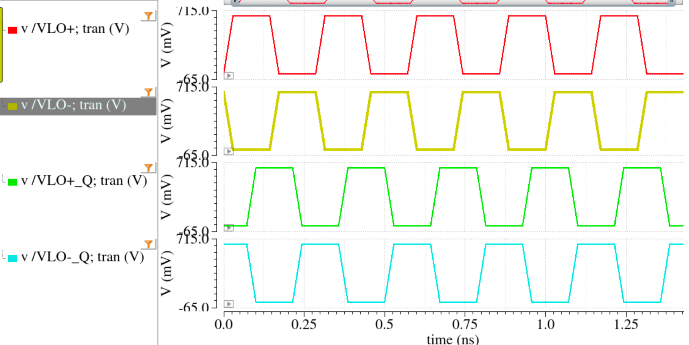 |
| **LNA + mixer: conversion gain** | **LNA + mixer: IIP3** |
| 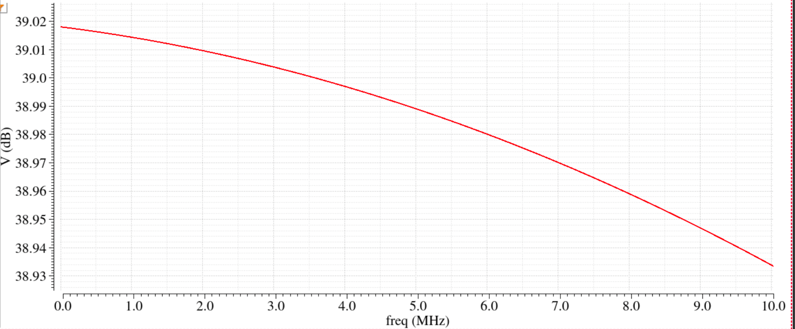 | 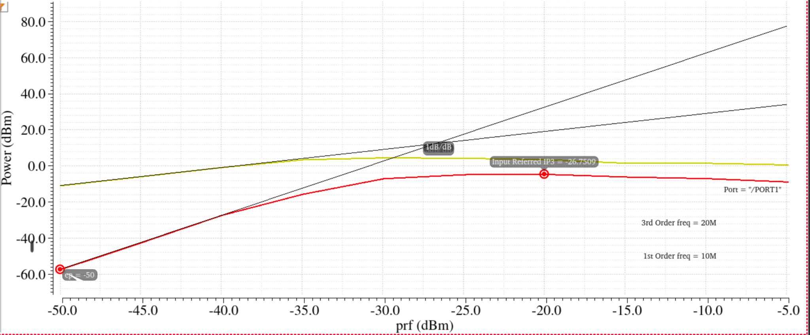 |
| **LNA + mixer: noise figure** | **LNA + mixer testbench** |
| 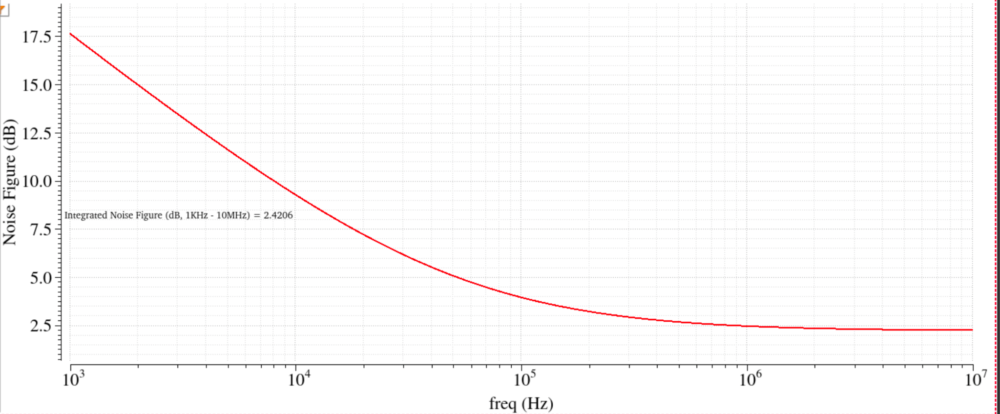 | 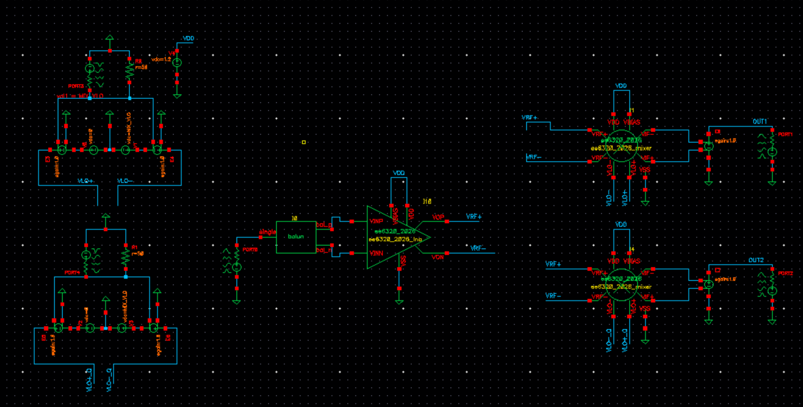 |

Mixer testbench: [figure](figures/mixer_testbench.png). Hand calculations: [page 1](figures/hand_calculations_1.png), [page 2](figures/hand_calculations_2.png)

## Files

```
report/MixerReport_EE23B114.pdf
figures/
cadence/ee6320_2026_mixer/   Mixer cell (schematic, symbol)
cadence/mixer_tb/            Testbench (schematic and ADE state)
```
