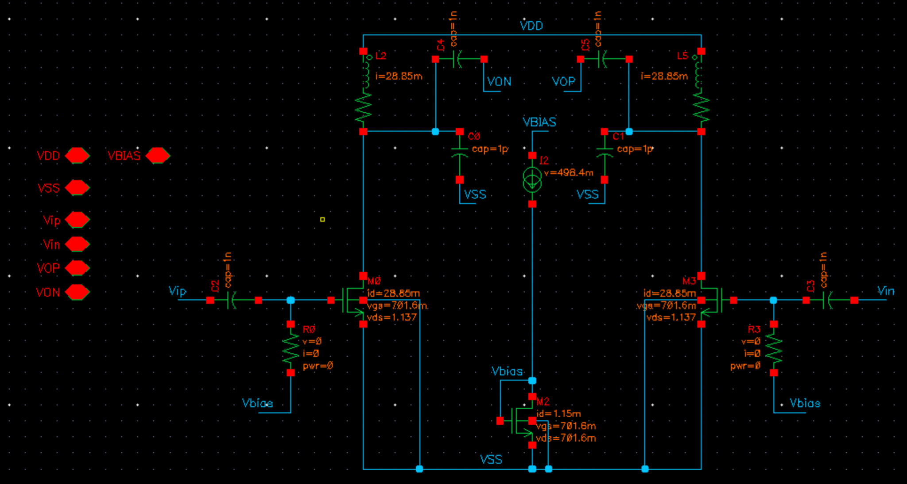
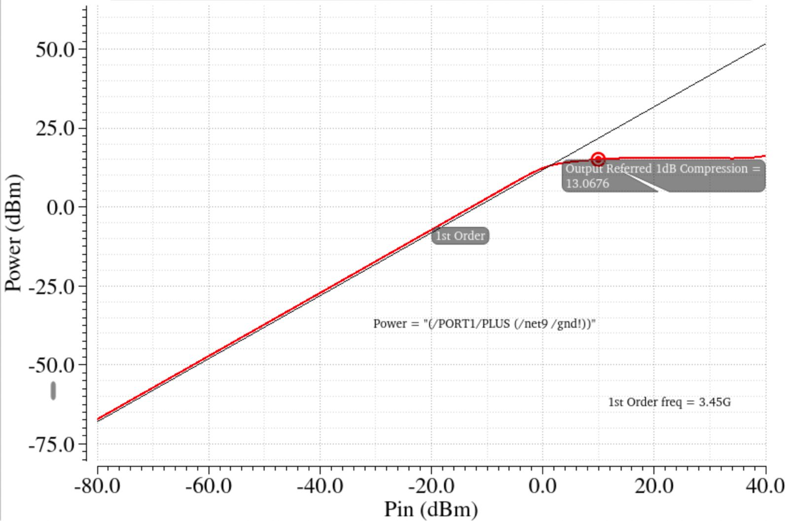
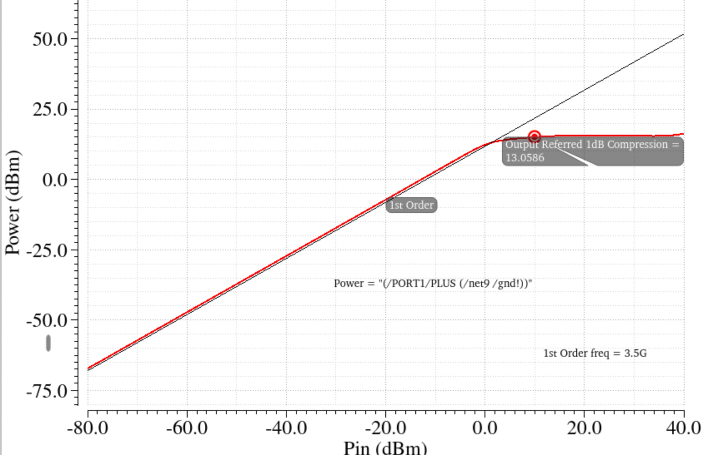
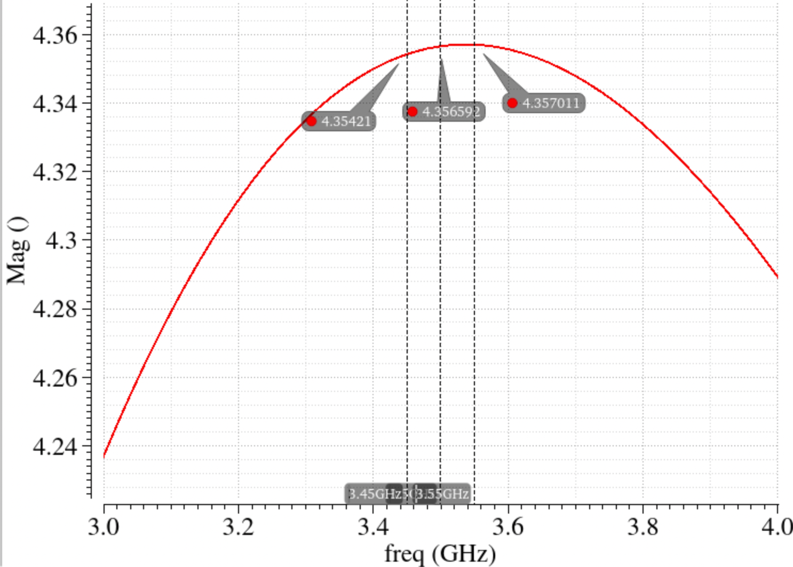
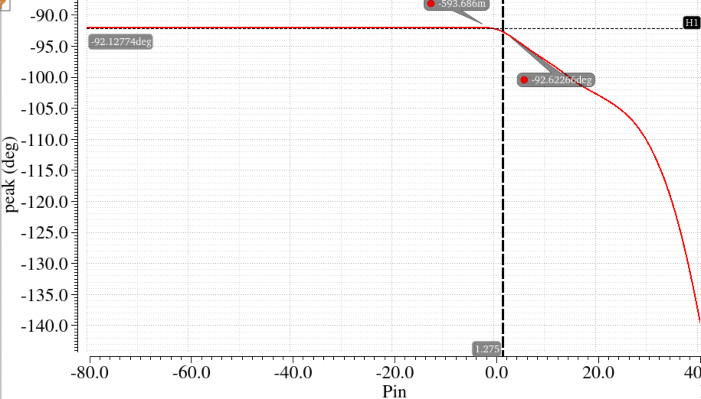
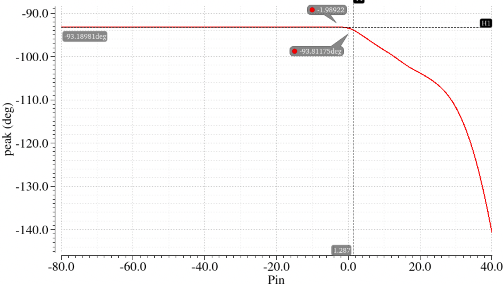
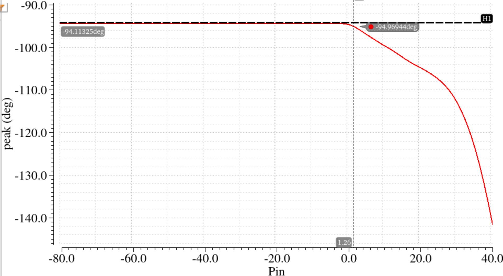
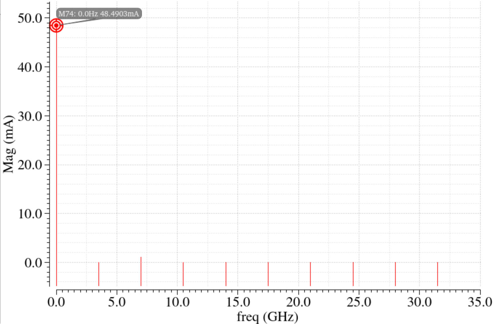

# Project 4: Differential Power Amplifier (3.45–3.55 GHz)

Differential power amplifier with an LC drain tank driving a 50 Ω load, designed in IBM 130 nm CMOS (VDD = 1.2 V) using at most two inductors.



## Specifications

| Specification | Target |
|---|---|
| Frequency | 3.45–3.55 GHz |
| Output P1dB | ≥ 20 mW (+13 dBm) |
| AM-PM deviation at P1dB | ≤ 3° |
| Voltage gain | ≥ 2 V/V |
| Inductors | Maximum 2 |
| Power | Minimise |

## Performance summary

| Design parameter | Design metric | Performance | Specification |
|---|---|---|---|
| Output P1dB | f0 = 3450 MHz | 13.06 dBm | ≥ +13 dBm |
| | f0 = 3500 MHz | 13.058 dBm | ≥ +13 dBm |
| | f0 = 3550 MHz | 13.0472 dBm | ≥ +13 dBm |
| AM-PM deviation (at P1dB) | f0 = 3450 MHz | 0.5° | ≤ 3° |
| | f0 = 3500 MHz | 0.63° | ≤ 3° |
| | f0 = 3550 MHz | 0.85° | ≤ 3° |
| Voltage gain (gate to drain) | f0 = 3450 MHz | 4.354 | ≥ 2 |
| | f0 = 3500 MHz | 4.355 | ≥ 2 |
| | f0 = 3550 MHz | 4.357 | ≥ 2 |
| Power (at 3.5 GHz) | PA average consumption (excluding bias) | 69.25 mW | Minimise |
| | Bias circuit consumption | 1.38 mW | Minimise |
| Other | Inductance used | 2 nH × 2 = 4 nH | — |
| | Simulator used | ADE L | — |

## Component values

| Component | Value |
|---|---|
| (W, L) MOS amplifier | 200 µm, 120 nm |
| (W, L) current mirror MOS | 10 µm, 120 nm |
| (L, C) drain tank | 2 nH × 2, 1 pF × 2 |
| Bias current | 1.15 mA |
| R_bias, C_coupling | 10 kΩ, 1 nF |
| VDD, R_load | 1.2 V, 50 Ω |

## Design procedure

Started with MOS characterisation of a 1 µm wide device to find the gm3 zero point, at a current density of 200 µA/µm. Using that bias point, increased the multiplier until the required specifications were met, then tuned the tank capacitor for the right gain band and tuned the bias circuit.

## Plots

| Output P1dB at 3450 MHz | Output P1dB at 3500 MHz |
|---|---|
|  |  |
| **Output P1dB at 3550 MHz** | **Voltage gain (gate to drain)** |
|  |  |
| **AM-PM at 3450 MHz** | **AM-PM at 3500 MHz** |
|  |  |
| **AM-PM at 3550 MHz** | **Current through VDD (3500 MHz)** |
|  |  |

PA testbench: [figure](figures/pa_testbench.png)

## Files

```
report/EE23B114_PA_Report.pdf
figures/
cadence/ee6320_2026_pa/   PA cell (schematic, symbol)
cadence/PA_TB/            Testbench (schematic and ADE state)
```
