# Project 3: LC VCO (6.9–7.1 GHz) with Divide-by-Two Quadrature Divider

Fully differential cross-coupled LC VCO with a 3-bit switched-capacitor bank for coarse tuning and MOS varactors for fine tuning, followed by a current-mode-latch divide-by-two that generates 0°, 90°, 180° and 270° LO signals (3.45–3.55 GHz) for the I/Q mixer of Project 2. Designed in IBM 130 nm CMOS (VDD = 1.2 V).

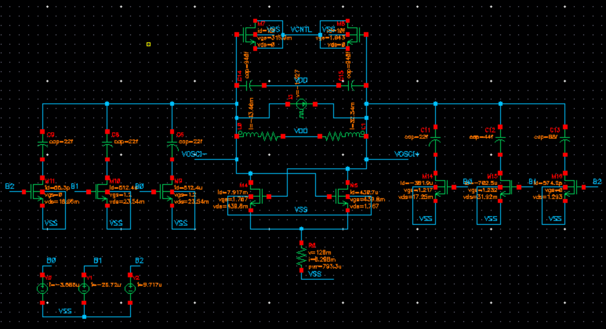

## Specifications

| Specification | Target |
|---|---|
| VCO frequency / divider output | 6.90–7.10 GHz / 3.45–3.55 GHz |
| Tuning range | 200 MHz (VCO), 100 MHz (LO) |
| Minimum differential output amplitude | 1.2 V |
| Phase noise | −122 dBc/Hz @ 1 MHz, −154 dBc/Hz @ 20 MHz |
| Fine-tuning KVCO | 70 MHz/V nominal |
| Inductors | Maximum 2 |
| Divider | Quadrature 0/90/180/270° outputs |
| Power | Minimise |

## Performance summary

| Design parameter | Design metric | Performance | Specification |
|---|---|---|---|
| Output amplitude (Vpp/2) | freq = 6900 MHz | 1.4816 V | ≥ 1.2 V |
| | freq = 7000 MHz | 1.6788 V | ≥ 1.2 V |
| | freq = 7100 MHz | 1.71 V | ≥ 1.2 V |
| Phase noise (1 MHz offset) | freq = 3450 MHz | −126.81 dBc/Hz | ≤ −122 dBc/Hz |
| | freq = 3500 MHz | −128.14 dBc/Hz | ≤ −122 dBc/Hz |
| | freq = 3550 MHz | −128.09 dBc/Hz | ≤ −122 dBc/Hz |
| Phase noise (20 MHz offset) | freq = 3450 MHz | −153.40 dBc/Hz | ≤ −154 dBc/Hz |
| | freq = 3500 MHz | −154.054 dBc/Hz | ≤ −154 dBc/Hz |
| | freq = 3550 MHz | −154.059 dBc/Hz | ≤ −154 dBc/Hz |
| Tuning range | Total tuning range | 248 MHz | ≥ 200 MHz |
| | Number of bits in coarse tuning | 3 bits | — |
| | Voltage range in fine tuning | 0–1.2 V | — |
| | Average KVCO | 68 MHz | 70 MHz/V |
| | % variation in KVCO | 14.55 % | Minimal |
| Power | VCO average power consumption (7000 MHz, excluding bias) | 1.2 × 8m = 9.6 mW | Minimal |
| Other | Net inductance used | Nothing other than tank inductance | — |
| | Simulator used | ADE L | — |

## Component values

**VCO**

| Component | Value |
|---|---|
| (W, L) cross-coupled MOS | 35 µm, 480 nm |
| (W, L) switching MOS | 15 µm, 120 nm |
| (C1, C2, C3) capacitor bank | 22 fF, 44 fF, 88 fF |
| (W, L) varactor MOS | 25 µm, 120 nm |
| Drain tank (L, C) | 330 pH × 2 = 660 pH, 940 fF / 2 = 470 fF |
| Tank R (Q = 20 at 7 GHz) | 580.567 Ω |
| Tail resistor | 20 Ω |

**Divide-by-two**

| Component | Value |
|---|---|
| (W, L) tail MOS | 20 µm, 120 nm |
| (R, C) drain filter | 500 Ω, 10 fF |
| (W, L) cross-coupled MOS | 15 µm, 120 nm |
| (W, L) inverter PMOS | 10 µm, 120 nm |
| (W, L) inverter NMOS | 5 µm, 120 nm |
| (R, C) biasing inverter | 10 kΩ, 1 pF |

## Design procedure

Started with gmR = 3 (gmR ≫ 1) to ensure start-up. Once the VCO oscillated, phase noise was high because of flicker noise from the tail current source and mirror MOSFETs, so the current source was replaced with a resistor, which significantly improved phase noise at 1 MHz offset. For the 20 MHz offset, the current and the divider transistor sizes were increased, since the divider's thermal noise adds to the output. The divider is a current-mode latch followed by self-biased inverters for the quadrature outputs, consuming nearly 3 mA in addition to the VCO.

## Plots

| VCO + divider schematic | Startup transient (Vop at 7000 MHz) |
|---|---|
| 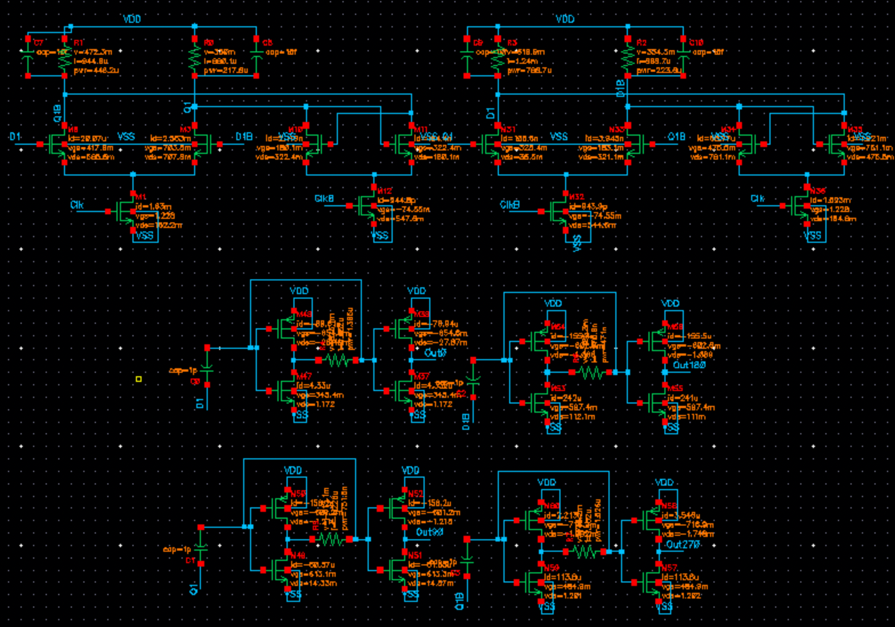 | 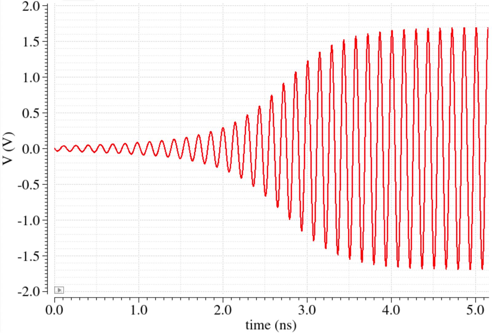 |
| **Frequency tuning range** | **KVCO** |
| 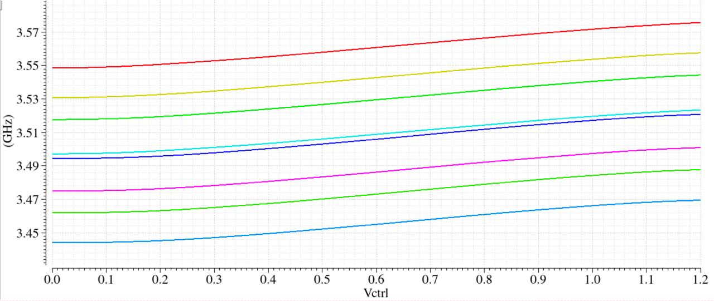 | 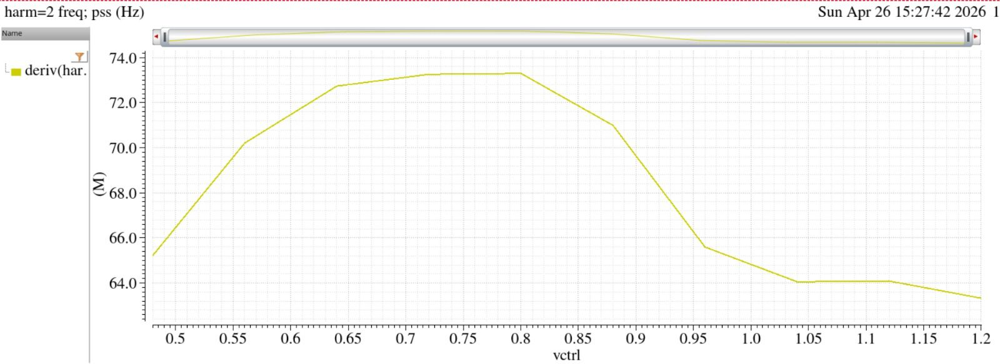 |
| **Phase noise at 3450 MHz** | **Phase noise at 3500 MHz** |
| 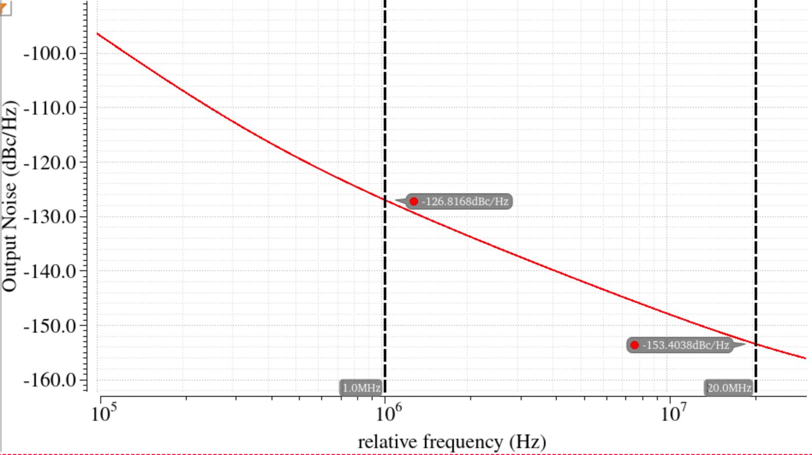 | 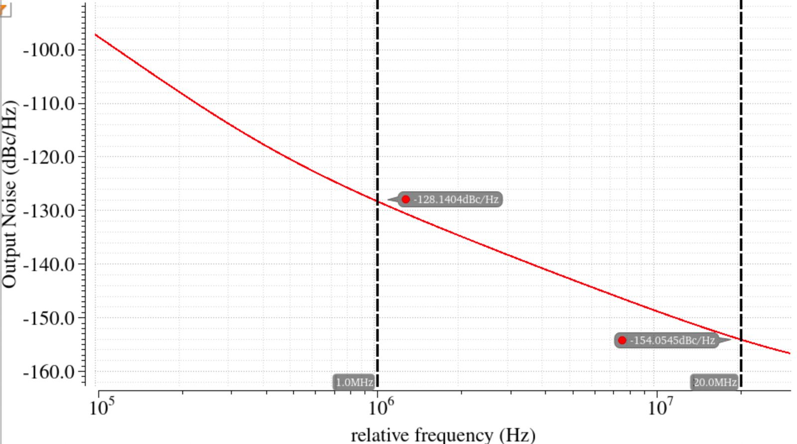 |
| **Phase noise at 3550 MHz** | **Divider outputs: 0°, 90°, 180°, 270°** |
| 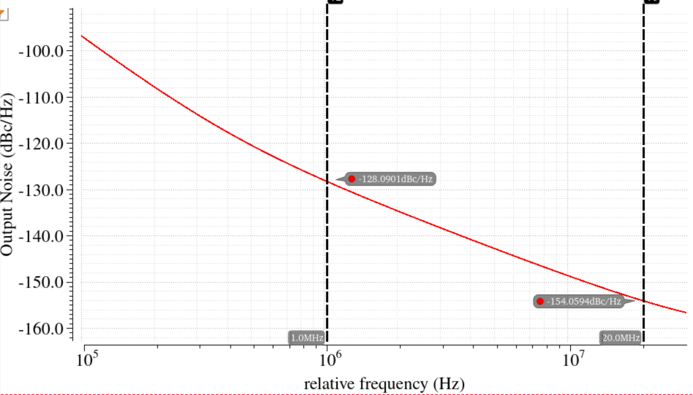 | 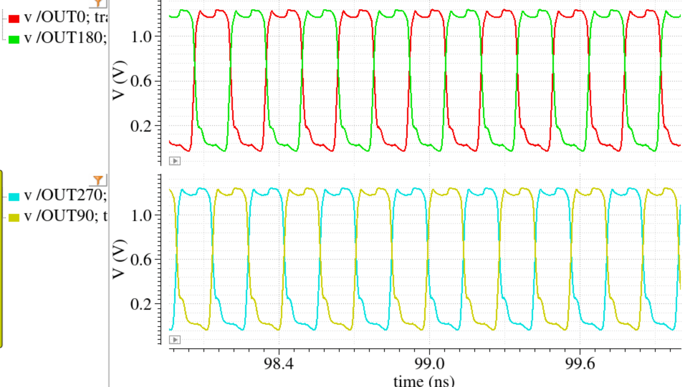 |
| **Differential amplitude at 6900 MHz** | **Differential amplitude at 7000 MHz** |
| 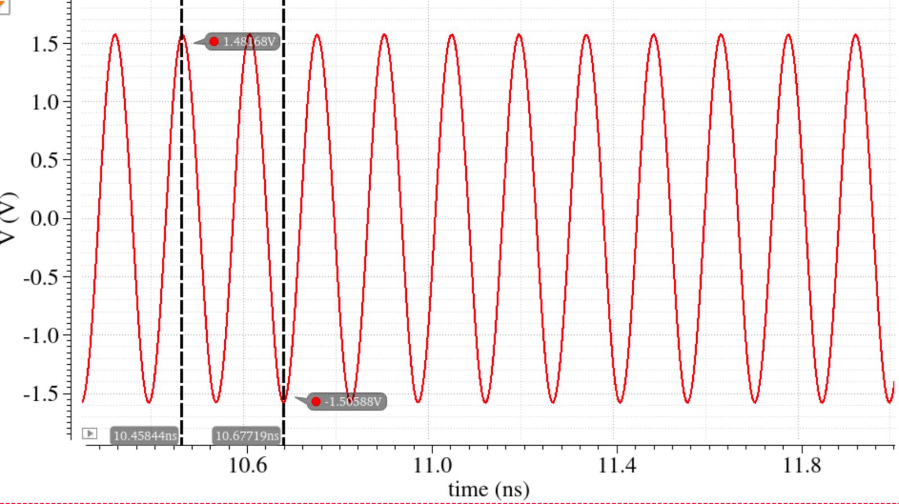 | 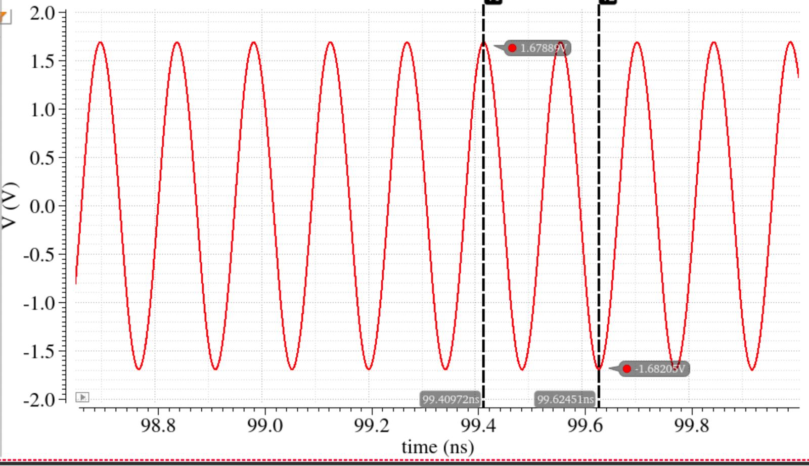 |
| **Differential amplitude at 7100 MHz** | **Single-ended outputs Vop and Von (7000 MHz)** |
| 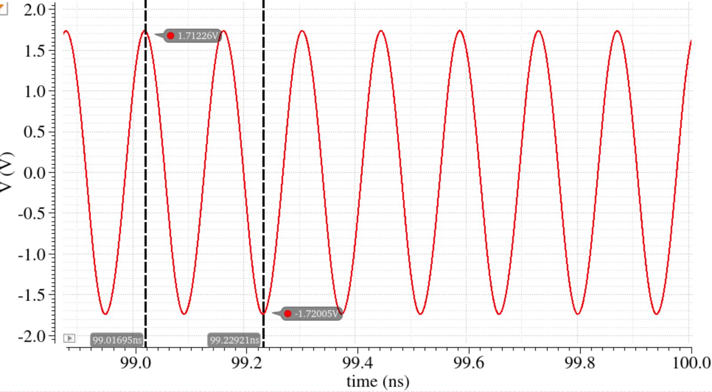 | 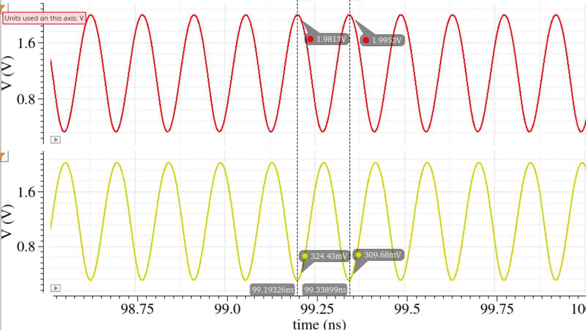 |

## Files

```
report/VCO_Report_EE23B114.pdf
figures/
cadence/ee6320_2026_vco/   VCO cell (schematic, symbol)
cadence/VCO_TB/            VCO testbench (schematic and ADE states)
cadence/VCO_Divider/       VCO + divider (schematic, symbol, ADE and Maestro states)
```
